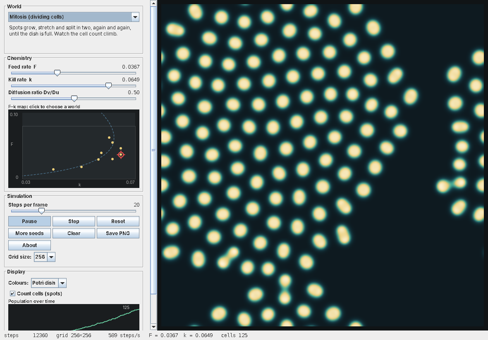
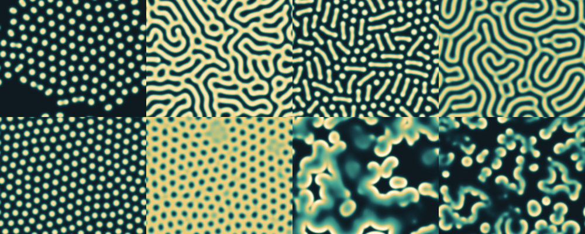
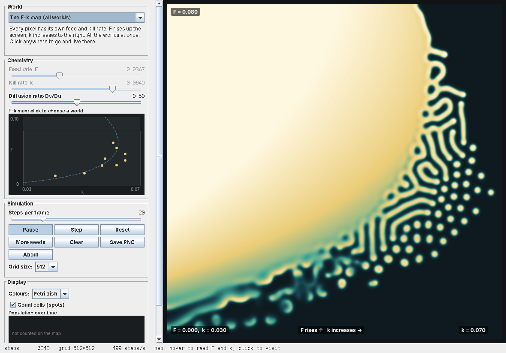

# Gray–Scott Lab

**Two chemicals, two simple rules, and a dozen different worlds: dividing cells, coral, worms, mazes and waves.**



Imagine a dish filled with a chemical that acts as food. Into it you drop a second chemical, a catalyst, that feeds on the first and turns it into more of itself. Fresh food is constantly poured in, and the catalyst is constantly drained away. Both chemicals slowly spread through the dish.

That's all there is to it. Yet depending on just two numbers, how fast the food is poured in and how fast the catalyst is drained, the dish fills with spots that divide like living cells, branching coral, wriggling worms, mazes, holes, or waves that never settle down.

This system is called the **Gray–Scott model**. Gray–Scott Lab lets you explore it: visit each world, watch it grow, paint into it with the mouse, and see a map of every world laid out side by side.

You don't need to know any chemistry or mathematics. Pick a world from the menu and watch.

---

## Getting started

Gray–Scott Lab is a single file. It needs **Java 17 or newer** and nothing else.

1. **Check whether you already have Java.** Open Terminal (on a Mac) or Command Prompt (on Windows) and type:

   ```
   java -version
   ```

   If it reports version 17 or higher, skip to step 3.

2. **Install Java if needed.** A free, trustworthy build is available from [Adoptium](https://adoptium.net). Download the installer for your computer and run it.

3. **Download** `GrayScottLab.java` from this repository.

4. **Run it.** In Terminal, go to the folder where you saved the file and type:

   ```
   java GrayScottLab.java
   ```

   The window opens after a few seconds, and the *Mitosis* world starts growing straight away.

---

## The worlds



*Top row: Mitosis, Coral, Worms, Maze. Bottom row: Stable spots, Holes, Travelling waves, Chaos.*

Choose a world from the menu at the top left. A short description appears underneath it.

| World | Feed F | Kill k | What happens |
|---|---|---|---|
| **Mitosis** | 0.0367 | 0.0649 | Spots grow, stretch and split in two, again and again, until the dish is full. |
| **Coral growth** | 0.0545 | 0.0620 | Branching fronts creep outward and fill the dish with a tangle of stripes. |
| **Worms** | 0.0460 | 0.0650 | Spots stretch into short, wriggling worms that jostle for space. |
| **Maze** | 0.0290 | 0.0570 | Stripes join into a labyrinth that keeps slowly rearranging itself. |
| **Stable spots** | 0.0300 | 0.0620 | Spots that hold their shape and keep their distance, like a leopard's coat. |
| **Holes** | 0.0390 | 0.0580 | The pattern turns inside out: a sea of catalyst pierced by round holes. |
| **Travelling waves** | 0.0140 | 0.0410 | Rings race outward, cancel each other out where they meet, then start again. |
| **Chaos** | 0.0180 | 0.0510 | Spots and squiggles are born, split and die in a restless churn. |
| **U-skate world** | 0.0620 | 0.0609 | A delicate region where small structures glide across the dish and then freeze in place. |
| **The F–k map** | all | all | Every world at once (see below). |

### Watching cells divide

The *Mitosis* world is the one to start with. A few drops of catalyst grow into round spots. Each spot swells, stretches into a peanut shape, and pinches in two. Then both halves do the same.

Tick **Count cells** and the lab counts the separate spots and plots them over time. You'll see a population curve that looks remarkably like bacteria growing in a real dish: slow at first, then faster, then levelling off once there's no room left. Nothing here is alive. It's two chemicals following two rules.

---

## The map of all worlds



Choose **The F–k map** from the menu. Now every pixel in the dish has its own feed and kill rate. The feed rate F rises from bottom to top, and the kill rate k increases from left to right. The whole range of worlds appears at once, side by side:

- The **pale region** on the left is where the catalyst wins completely and fills everything.
- The **dark region** on the right is where the catalyst is drained too fast to survive, leaving plain food.
- All the interesting patterns live in the **narrow band between them**: stripes, spots, worms and waves, blending into one another.

Hover over the map to read the F and k values at that point. **Click anywhere** to go and live in that world: the lab sets F and k to those values and starts a fresh dish.

The small chart under the sliders shows the same space. Each named world is a gold dot and your current world is the red target, and you can click the chart to jump anywhere too. The dashed curve marks a mathematical boundary: to its right, plain food is the only steady state the dish can settle into.

---

## The controls

### Chemistry

| Control | What it does |
|---|---|
| **Feed rate F** | How fast fresh food is poured into the dish. |
| **Kill rate k** | How fast the catalyst is drained away. |
| **Diffusion ratio** | How fast the catalyst spreads compared with the food. Normally 0.5, so the food spreads twice as fast. That difference is what makes patterns possible. Push it towards 1 and the patterns fade. |

### Simulation

| Control | What it does |
|---|---|
| **Steps per frame** | How many steps are calculated between screen updates. Raise it to speed things up. |
| **Play / Pause, Step** | Stop the action, or advance it one step at a time. |
| **Reset** | Start the current world again from a few drops. |
| **More seeds** | Restart with many drops scattered across the dish. Some worlds can't grow from just a few. |
| **Clear** | Empty the dish back to plain food. |
| **Save PNG** | Save the current picture as an image file. |
| **Grid size** | 128 to 512 pixels across. Larger dishes hold more pattern but run more slowly. |

### Display

- **Colours** offers four schemes: *Petri dish*, *Ink*, *Coral reef* and *Thermal*.
- **Count cells** counts the separate blobs of catalyst and plots the population over time.

### Using the mouse

- **Left-drag** to drop catalyst into the dish.
- **Right-drag** to wash an area back to plain food.

Try painting your initials into the *Mitosis* world and watch them break up into cells, or cut a line through the *Coral* and watch it grow back.

---

## How it works

For the curious, here are the two rules. **U** is the food and **V** is the catalyst:

```
dU/dt  =  Du ∇²U  −  U·V²  +  F·(1 − U)
dV/dt  =  Dv ∇²V  +  U·V²  −  (F + k)·V
```

Reading each term in plain English:

- **∇²U and ∇²V** describe spreading: each chemical flows from where there's more of it to where there's less.
- **U·V²** is the reaction. One unit of food meeting two units of catalyst becomes a third unit of catalyst. It's subtracted from the food and added to the catalyst.
- **F·(1 − U)** pours in fresh food, topping it back up towards full.
- **(F + k)·V** drains the catalyst away.

The patterns come from a tug-of-war. Catalyst makes more of itself, but in doing so it uses up the food around it. Because food spreads faster than catalyst, a patch of catalyst ends up surrounded by a hungry zone where nothing else can grow. That's what sets the size and spacing of the spots and stripes. Alan Turing was the first to describe this kind of mechanism, in 1952, as a possible explanation for animal markings.

The lab works on a grid of pixels and advances the two rules one small step at a time. Each pixel's change depends only on its own chemicals and its eight neighbours. The dish wraps around at the edges, so the left side joins the right and the top joins the bottom. The map is the exception: it has closed edges. The calculation runs on all your computer's processor cores and is written in plain Java, with no extra libraries.

---

## Credits

**Architect:** Mario Gianota
**Implementation:** Claude (Anthropic)

Released under the MIT licence.

### Further reading

- P. Gray and S. K. Scott, "Autocatalytic reactions in the isothermal, continuous stirred tank reactor", *Chemical Engineering Science* 38, 29–43 (1983). The original model.
- J. E. Pearson, "Complex patterns in a simple system", *Science* 261, 189–192 (1993). The paper that revealed how rich its patterns are.
- Robert Munafo, [*Reaction–Diffusion by the Gray–Scott Model*](https://mrob.com/pub/comp/xmorphia/). A detailed map of the F–k space and its worlds.
- A. M. Turing, "The chemical basis of morphogenesis", *Philosophical Transactions of the Royal Society B* 237 (1952).

If you enjoy this, try **Swift–Hohenberg Lab**, its companion, which grows fingerprints and sand ripples from the same kind of instability.
